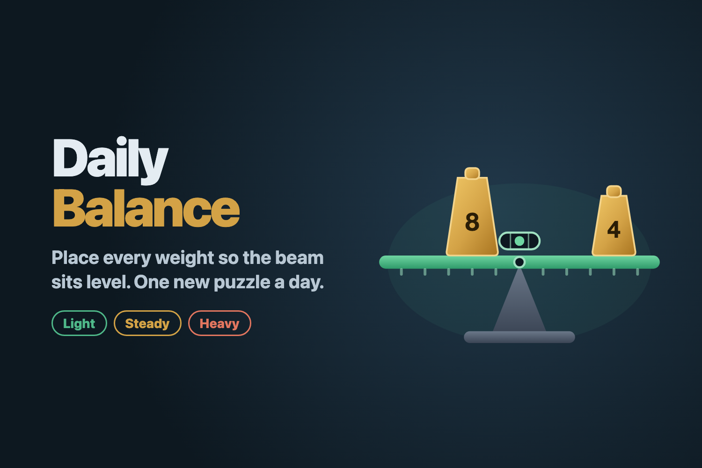

# Daily Balance

A daily weights puzzle for Reddit, built on Devvit Web.

Each day everyone gets the same beam. Some grey iron weights are already fixed on it, tipping it to one side.

## How to play

1. Tap a gold weight to pick it up.
2. Tap a spot on the beam to set it down. Tap it on the beam again to move it.
3. Make the beam level with every gold weight on it.

A weight pushes down harder the farther it is from the middle: a 4 on spot 3 counts as 4 × 3 = 12. The totals under the beam show each side, so make them match.

- **Score:** each time you set a weight down is one move. A perfect game is one move per weight. A hint places one weight for you and adds 2. Lower is better.
- **Difficulty:** Monday and Tuesday are Light (3 weights), Wednesday to Friday are Steady (4), and the weekend is Heavy (5, with fewer correct answers).
- **Streaks:** solve each day's puzzle on that day (UTC). Every 5 days in a row earns a streak freeze, and you can hold up to 2. A missed day automatically uses a freeze so the streak survives. Miss more days than you have freezes and it starts over.

## How it works

- Puzzles come from the date, so they need no daily content work, and every puzzle is checked to have only a few solutions.
- The server re-checks every submitted board before it counts, keeps streaks and freezes, a daily rank and a score spread, and posts a new puzzle at 00:00 UTC.

## Run it

You need Node 22 or newer and a Reddit account.

1. `npm install`
2. `npm run login` and approve in the browser.
3. Create a small private subreddit that you moderate, for testing.
4. `npm run dev` (or `npx devvit playtest r/YOUR_TEST_SUB`). Installing the app creates today's puzzle post. Moderators can also use the subreddit menu item "Post today's Daily Balance".
5. When it plays well, run `npx devvit upload`. Don't publish it during the hackathon.

If upload says the name `daily-balance` is taken, change `name` in `devvit.json` and `package.json`.

## Code

- `src/shared/puzzle.ts`: puzzle generator, solution counter and checker (shared by client and server).
- `src/shared/streak.ts`: streak and streak-freeze rules (shared, unit-tested).
- `src/server`: Hono routes for loading, saving results, comments, the daily post and install trigger.
- `src/client`: React splash (feed view) and game (expanded view). The beam is plain SVG.

`npm run test:unit` checks a full year of puzzles and the streak rules.

The app icon is `assets/icon.png` (set under `marketingAssets` in `devvit.json`).
